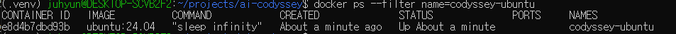
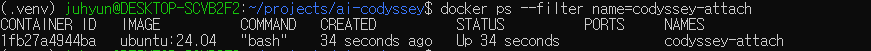
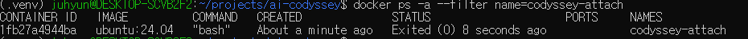
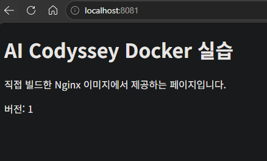
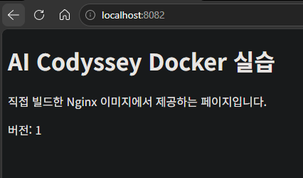
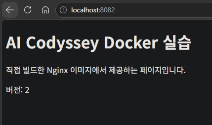
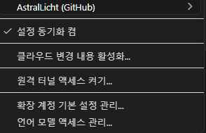
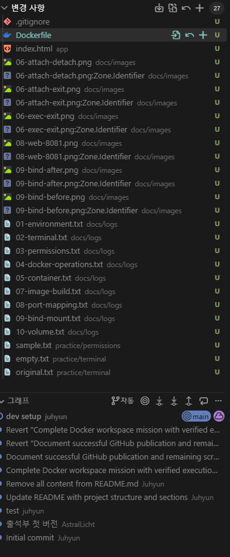

# 개발자용 작업실 구축 실습

Windows + WSL 2 Ubuntu에서 터미널, Docker, Git/GitHub를 사용해 개발 워크스테이션을 구성한 기록입니다. 실행 환경을 이미지로 재현하고, 포트 매핑·바인드 마운트·볼륨의 역할을 실제 결과로 확인합니다.

## 1. 실행 환경

| 항목 | 실습 환경 |
|---|---|
| 호스트 OS | Windows |
| Linux 환경 | WSL 2 / Ubuntu 26.04.1 LTS |
| 커널 | 6.18.40.1-microsoft-standard-WSL2 |
| 쉘 | Bash 5.3.9 |
| Docker | Docker Desktop / Docker Engine 29.9.2 |
| Git | 2.53.0 |
| 편집기 | Visual Studio Code |
| GitHub 저장소 | https://github.com/AstralLicht/ai-codyssey |

명령은 저장소 루트의 Ubuntu Bash에서 실행합니다. Docker Desktop을 실행하고 해당 Ubuntu의 WSL Integration을 활성화해야 합니다. Python 가상환경은 이번 Docker 실습에 필요하지 않습니다.

[환경 확인 명령 및 출력](docs/logs/01-environment.txt)

## 2. 수행 체크리스트

- [x] 저장소 위치·원격 연결 확인
- [x] 실행 환경 및 버전 기록
- [x] 터미널 파일·폴더 조작
- [x] 파일·디렉터리 권한 변경
- [x] Docker 엔진 점검·이미지 및 컨테이너 운영
- [x] hello-world 및 Ubuntu 컨테이너 실행
- [x] exec·attach 실습 증거 파일 준비
- [x] Dockerfile 직접 작성 및 커스텀 이미지 빌드
- [x] 포트 매핑 및 HTTP 200 응답 확인
- [x] 바인드 마운트 변경 반영 확인
- [x] 컨테이너 삭제 후 볼륨 데이터 유지 확인
- [x] Git 설정 로그·VS Code/GitHub 연동 캡처 준비

로그와 이미지의 상세 결과는 각 절의 상대경로 링크에서 확인합니다.

## 3. 주요 파일

| 경로 | 역할 |
|---|---|
| `Dockerfile` | Nginx 기반 커스텀 이미지 정의 |
| `app/index.html` | 웹페이지 원본 |
| `practice/terminal/` | 파일 조작 실습 결과 |
| `practice/permissions/` | 권한 변경 실습 결과 |
| `docs/logs/` | 수행 명령과 실제 출력 |
| `docs/images/` | 브라우저·컨테이너 조작·GitHub 연동 캡처 |
| `attend.py` | 기존 파일이며 이번 Docker 실습과 별개 |

## 4. 터미널 기본 조작

```bash
pwd
ls -la
mkdir -p practice/terminal
cd practice/terminal
touch empty.txt
printf 'Hello, terminal!\n' > original.txt
cat original.txt
cp original.txt copied.txt
mv copied.txt renamed.txt
rm renamed.txt
mkdir temporary-dir
rmdir temporary-dir
cd ..
pwd
```

`original.txt`의 내용과 빈 `empty.txt` 생성, 복사본의 이름 변경 및 삭제를 확인했습니다.

- 절대 경로: `/home/juhyun/projects/ai-codyssey/practice/terminal`처럼 루트 `/`부터 표시합니다.
- 상대 경로: 저장소 루트에서 `practice/terminal`처럼 현재 위치를 기준으로 표시합니다.
- `ls -la`: 숨김 파일을 포함해 상세 목록을 확인합니다.

[명령 및 실제 출력](docs/logs/02-terminal.txt)

## 5. 파일·디렉터리 권한

```bash
stat -c '%a %A %n' practice/permissions/sample.txt practice/permissions/sample-dir
chmod 600 practice/permissions/sample.txt
chmod 700 practice/permissions/sample-dir
stat -c '%a %A %n' practice/permissions/sample.txt practice/permissions/sample-dir
chmod 644 practice/permissions/sample.txt
chmod 755 practice/permissions/sample-dir
stat -c '%a %A %n' practice/permissions/sample.txt practice/permissions/sample-dir
```

확인 결과:

```text
파일:     644 -rw-r--r-- → 600 -rw------- → 644 -rw-r--r--
디렉터리: 755 drwxr-xr-x → 700 drwx------ → 755 drwxr-xr-x
```

소유자·그룹·기타 사용자 순서이며 `r=4`, `w=2`, `x=1`을 더합니다. 파일의 `x`는 실행, 디렉터리의 `x`는 진입·내부 항목 접근 권한입니다. 디렉터리에 항목을 생성·삭제하려면 일반적으로 `w`와 `x`가 함께 필요합니다.

[변경 전후 실제 출력](docs/logs/03-permissions.txt)

## 6. Docker 점검·운영

```bash
docker --version
docker info
docker pull nginx:alpine
docker images
docker run -d --name codyssey-ops-check nginx:alpine
docker ps
docker logs codyssey-ops-check
docker stats --no-stream codyssey-ops-check
docker stop codyssey-ops-check
docker ps -a
docker rm codyssey-ops-check
```

엔진의 Client/Server 정보, 이미지 다운로드, 실행 상태, Nginx 시작 로그와 자원 사용량을 확인했습니다. 중지 후 `Exited (0)`을 확인하고 실습 컨테이너를 삭제했습니다. 이미지가 실행 환경의 기반이고, 컨테이너는 그 이미지를 바탕으로 생성한 실행 인스턴스입니다.

[운영 명령 및 실제 출력](docs/logs/04-docker-operations.txt)

## 7. 컨테이너 내부 조작과 종료

```bash
docker run --rm hello-world
docker run -d --name codyssey-ubuntu ubuntu:24.04 sleep infinity
docker exec codyssey-ubuntu bash -lc 'echo "Hello from Ubuntu container"; pwd; ls; cat /etc/os-release'
docker exec -it codyssey-ubuntu bash
```

대화형 Bash 내부에서 다음을 실행했습니다.

```bash
echo "Inside container"
pwd
exit
```

다음은 attach 실습 명령입니다.

```bash
docker run -dit --name codyssey-attach ubuntu:24.04 bash
docker attach codyssey-attach
```

내부에서 `echo "Attached to main shell"`을 실행한 뒤 `Ctrl+P`, `Ctrl+Q`를 순서대로 눌러 연결만 해제합니다. `docker ps`로 실행 상태를 확인한 다음 다시 attach하여 `exit`합니다.

```bash
docker ps --filter name=codyssey-attach
docker attach codyssey-attach
# 컨테이너 Bash에서 exit 입력
docker ps -a --filter name=codyssey-attach
```

| 동작 | 결과 |
|---|---|
| exec로 추가한 Bash에서 exit | 주 프로세스가 실행 중이면 컨테이너 유지 |
| attach에서 Ctrl+P, Ctrl+Q | 연결만 해제 |
| 주 프로세스 Bash에서 exit | 컨테이너 종료, Exited (0) 확인 |

[hello-world·Ubuntu 실행 로그](docs/logs/05-container.txt)







## 8. Dockerfile 기반 커스텀 이미지

공식 `nginx:alpine`을 선택했습니다. 웹 서버가 준비된 기반 위에 정적 콘텐츠를 추가하는 방식입니다.

```dockerfile
FROM nginx:alpine

LABEL org.opencontainers.image.title="ai-codyssey-web"

COPY app/ /usr/share/nginx/html/
```

- `LABEL`: 이미지 식별용 제목을 추가합니다.
- `COPY`: 기본 문서 경로에 직접 작성한 HTML을 포함합니다.

```bash
docker build -t ai-codyssey-web:1.0 .
docker image ls ai-codyssey-web
```

실습 당시 `ai-codyssey-web:1.0`의 이미지 ID는 `e7a85d0b772c`였습니다. 당시 사용한 베이스 digest는 `sha256:785835ea65db4bba6f021acc0f3be91b0fef76a53fe41f8588c6698d2aed0606`입니다. 태그와 빌드 시점에 따라 재빌드 결과의 ID는 달라질 수 있습니다.

[Dockerfile·HTML·빌드 실제 출력](docs/logs/07-image-build.txt)

## 9. 포트 매핑·접속

```bash
docker run -d --name codyssey-web -p 8081:80 ai-codyssey-web:1.0
docker ps --filter name=codyssey-web
curl -i --max-time 10 http://localhost:8081
docker logs codyssey-web
```

PC의 8081 포트를 컨테이너의 Nginx 80 포트에 연결했습니다. 브라우저와 curl에서 접근했으며 `HTTP/1.1 200 OK`와 HTML을 확인했습니다. 포트 매핑은 호스트에서 컨테이너 서비스에 접근할 입구를 제공합니다.

[접속 및 서버 실제 로그](docs/logs/08-port-mapping.txt)



## 10. 바인드 마운트 변경 반영

저장소 루트에서 실행합니다.

```bash
docker run -d --name codyssey-bind -p 8082:80 \
  --mount "type=bind,source=$(pwd)/app,target=/usr/share/nginx/html,readonly" \
  ai-codyssey-web:1.0

docker inspect --format '{{json .Mounts}}' codyssey-bind
curl -fsS --max-time 10 http://localhost:8082
sed -i 's/버전: 1/버전: 2/' app/index.html
curl -fsS --max-time 10 http://localhost:8082
curl -fsS --max-time 10 http://localhost:8081
```

| 실습 서버 | 수정 후 결과 | 이유 |
|---|---|---|
| 8082 / codyssey-bind | 버전 2 | 연결한 호스트 파일을 읽음 |
| 8081 / codyssey-web | 버전 1 | 빌드 당시 복사한 이미지 파일을 읽음 |

`Type: bind`, `RW: false`를 확인했습니다. 호스트 파일을 수정하자 재빌드·재시작 없이 반영됐습니다. 컨테이너에서는 읽기 전용이어도 호스트에서 원본을 수정할 수 있습니다.

[변경 전후 실제 응답](docs/logs/09-bind-mount.txt)





**재현 시 주의:** 현재 저장소의 HTML은 버전 2입니다. 위 전후 비교를 재현하려면 먼저 `app/index.html`의 문구를 버전 1로 되돌려 이미지를 빌드한 다음, 마운트 후 버전 2로 수정합니다. 현재 버전 2로 바로 빌드하면 두 서버 모두 버전 2로 시작합니다. 바인드 마운트 경로는 고정된 개인 경로 대신 `$(pwd)/app`을 사용합니다.

## 11. Docker 볼륨 영속성

```bash
docker volume create codyssey-data
docker run -d --name codyssey-volume-before \
  --mount type=volume,source=codyssey-data,target=/data \
  ubuntu:24.04 sleep infinity

docker exec codyssey-volume-before bash -lc \
  'printf "Volume persistence test\n" > /data/message.txt; cat /data/message.txt'

docker stop codyssey-volume-before
docker rm codyssey-volume-before
docker volume inspect codyssey-data

docker run -d --name codyssey-volume-after \
  --mount type=volume,source=codyssey-data,target=/data \
  ubuntu:24.04 sleep infinity

docker exec codyssey-volume-after cat /data/message.txt
```

컨테이너 삭제 전후 확인 결과:

```text
Volume persistence test
```

첫 컨테이너를 삭제한 뒤 새 컨테이너에 같은 볼륨을 연결해 기존 파일을 읽었습니다. 바인드 마운트는 사용자가 지정한 호스트 경로를 연결하며, 이름 있는 볼륨은 Docker가 관리하는 저장 공간입니다. 둘 다 컨테이너 외부에 데이터를 둘 수 있습니다.

[생성·연결·삭제 전후 실제 출력](docs/logs/10-volume.txt)

## 12. Git·GitHub·VS Code

```bash
git remote -v
git status
git config --get init.defaultBranch
```

`origin`은 이 GitHub 저장소를 가리키며, 기본 브랜치는 `main`입니다. 사용자 정보 등 일부 값은 공개 로그에서 마스킹합니다.

[Git 설정 목록 및 원격 연결 로그](docs/logs/11-git.txt)





Git은 로컬 변경 이력을 기록하고, GitHub는 원격 저장소를 통한 공유와 협업을 제공합니다. `U`는 아직 추적하지 않는 파일을 의미합니다.

제출에서 제외할 항목은 기존 `.gitignore`를 유지하면서 다음 규칙을 확인합니다.

```gitignore
.venv/
.ruff_cache/
__pycache__/
*.pyc
.env
*:Zone.Identifier
```

## 13. 트러블슈팅

### 사례 1: PNG 옆에 :Zone.Identifier 파일 표시

- 문제: 소스 제어에 `06-exec-exit.png:Zone.Identifier` 등의 파일이 함께 나타났습니다.
- 원인 가설: Windows에서 전달된 다운로드 출처 정보가 WSL에서 별도 파일로 보이는 것으로 판단했습니다.
- 확인: VS Code 변경 목록에서 PNG와 동일한 이름에 `:Zone.Identifier`가 붙은 항목들을 확인했습니다.
- 해결 방법: `.gitignore`에 `*:Zone.Identifier`를 추가합니다. 실제 PNG는 제출 대상에 포함합니다.
- 최종 확인: 아래 결과에 해당 파일이 더 이상 나타나지 않는지 제출 전에 확인합니다. 이 검증 출력은 아직 본 문서에 첨부하지 않았습니다.

```bash
git status --short --untracked-files=all docs/images/
```

### 사례 2: favicon.ico 요청에 404 발생

- 문제: 브라우저 접속 후 Nginx 로그에 `/favicon.ico`의 `404`와 파일 없음 메시지가 기록됐습니다.
- 원인 가설: 브라우저가 탭 아이콘을 자동 요청했지만 해당 파일은 제작하지 않았습니다.
- 확인: Nginx 로그에서 파일 없음 메시지를 확인했고, `/` 요청은 `200`, curl도 `200 OK`와 정상 HTML을 반환했습니다.
- 해결/대안: 본문 동작은 정상임을 확인했습니다. 아이콘은 과제 필수 기능이 아니므로 404는 그대로 남겼습니다. 필요하면 `app/favicon.ico`를 추가한 뒤 이미지를 재빌드할 수 있습니다.

[404와 정상 응답을 함께 확인한 로그](docs/logs/08-port-mapping.txt)

## 14. 재실행 및 정리

컨테이너 이름이 이미 존재하면 상태를 확인하고 기존 컨테이너를 시작하거나, 해당 실습 컨테이너를 삭제한 뒤 새로 생성합니다.

```bash
docker ps -a
docker start codyssey-web
# 웹 서버만 중지
docker stop codyssey-web
```

이미지에 포함된 HTML과 외부 마운트 데이터는 구분해야 합니다. `docker save`는 이미지 밖의 바인드 마운트 파일과 볼륨 데이터를 함께 저장하지 않습니다.

실습 컨테이너 정리는 다음과 같이 수행할 수 있습니다. `docker rm -f`는 실행 중인 해당 컨테이너도 강제로 종료·삭제합니다.

```bash
docker rm -f codyssey-web codyssey-bind codyssey-ubuntu codyssey-attach codyssey-volume-after
```

이 명령은 `codyssey-data` 볼륨을 삭제하지 않습니다. 실습 데이터를 더 이상 보관하지 않을 때만 별도로 실행합니다.

```bash
docker volume rm codyssey-data
```

## 15. 최종 제출 점검

- 로그와 캡처에 비밀번호·토큰·인증 코드가 없는지 확인합니다.
- README의 이미지·로그 링크가 GitHub에서 열리는지 확인합니다.
- Git 사용자 이름·이메일 설정이 실제로 존재하는지 확인합니다.
- `.venv`, 캐시 및 `:Zone.Identifier`가 커밋 대상에서 제외됐는지 확인합니다.
- 커밋·푸시 후 원격 저장소에서 최신 README와 증거를 확인합니다.
- 선택 과제인 Docker Compose와 SSH 키 설정은 본 필수 실습 범위에 포함하지 않았습니다.
